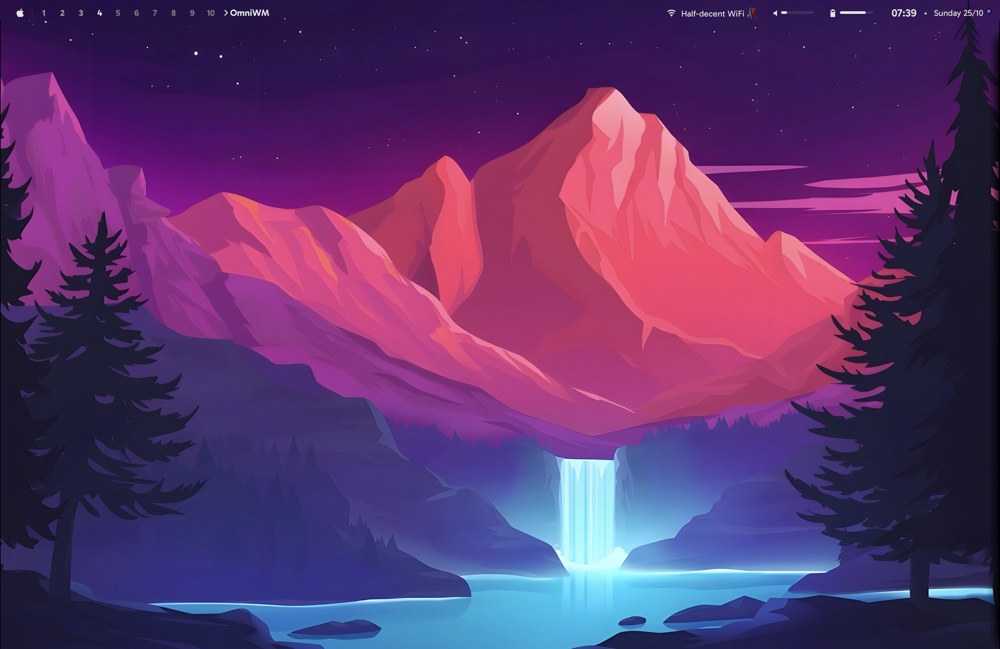
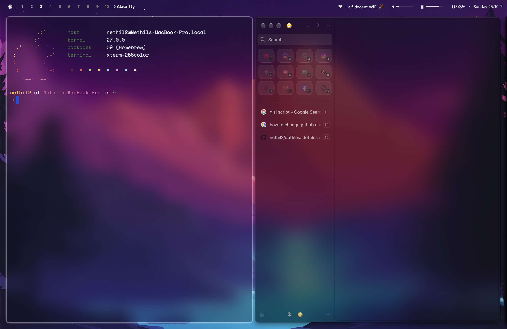

# Nethil2 MacOs

<p align="center">
  
  
</p>

This repo is a complete snapshot of my macOS setup so I can recreate it on a new MacBook.

## Quick install (recommended)

```sh
git clone --recurse-submodules https://github.com/nethil2/dotfiles
cd dotfiles
./install.sh
```

The installer installs Homebrew (if missing), installs all formulae/casks, symlinks configs from `dotfiles/` into `~/.config` and app support dirs, builds SbarLua, and starts services.

## Manual steps (if you prefer)

<details>
<summary>Click to expand manual installation</summary>

### 1) Install Homebrew

```sh
/bin/bash -c "$(curl -fsSL https://raw.githubusercontent.com/Homebrew/install/HEAD/install.sh)"
```

For Apple Silicon, make sure Homebrew is in your PATH:

```sh
echo 'eval "$(/opt/homebrew/bin/brew shellenv)"' >> ~/.zprofile
eval "$(/opt/homebrew/bin/brew shellenv)"
```

### 2) Install all packages

```sh
# Taps
brew tap FelixKratz/formulae

# Formulae
brew install coreutils fish python lua neovim ripgrep fastfetch \
  macchina btop cava jq \
  koekeishiya/formulae/skhd \
  FelixKratz/formulae/sketchybar \
  emacs opencode yabai \
  ca-certificates cask gettext gmp gnutls iniparser json-c \
  libidn2 libomp libtasn1 libunistring libuv lpeg luajit luv lz4 \
  media-control mpdecimal nettle oniguruma openssl@4 p11-kit \
  pcre2 portaudio readline removemacai sqlite tree-sitter unibilium utf8proc xz yyjson zstd

# Casks
brew install --cask alacritty omniwm zen wispr-flow vorssaint \
  font-space-mono-nerd-font font-gabarito font-jetbrains-mono-nerd-font font-sketchybar-app-font \
  microsoft-outlook
```

### Manual apps

- Alfred 5 — https://www.alfredapp.com/
- CleanShot X — https://cleanshot.com/

### 3) Clone and symlink

```sh
git clone --recurse-submodules https://github.com/nethil2/dotfiles
cd dotfiles
./scripts/link.sh
```

### 4) Build deps & start services

```sh
(git clone https://github.com/FelixKratz/SbarLua.git /tmp/SbarLua && cd /tmp/SbarLua/ && make install && rm -rf /tmp/SbarLua/)
chmod +x ~/.config/sketchybar/sketchybarrc ~/.config/skhd/*.sh 2>/dev/null
open -a OmniWM
brew services start sketchybar
skhd --start-service
```

</details>

## Permissions

Grant **Accessibility** access to: OmniWM, SketchyBar, skhd, Alfred, CleanShot X in  
**System Settings > Privacy & Security > Accessibility**. Add them to **Login Items & Extensions** if desired.

## Notes

- Configs are symlinked from `dotfiles/` so local changes sync directly to the repo.
- SketchyBar is a git submodule pointing to [nethil2/sketchybar](https://github.com/nethil2/sketchybar). Clone with `--recurse-submodules`.
